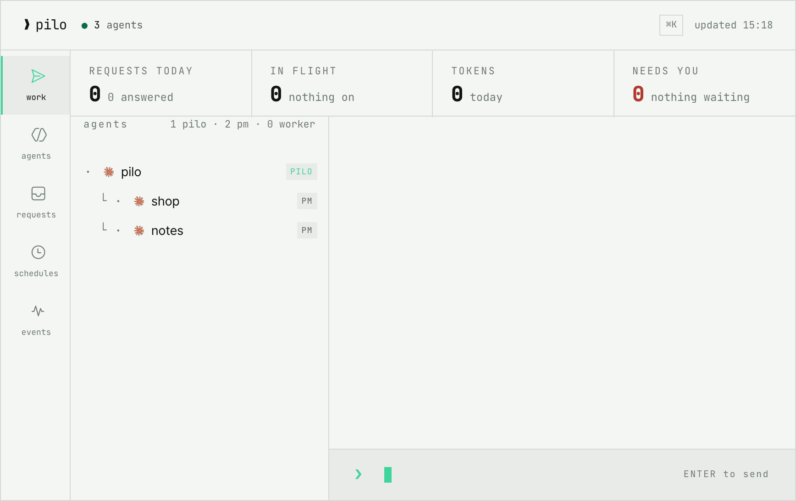
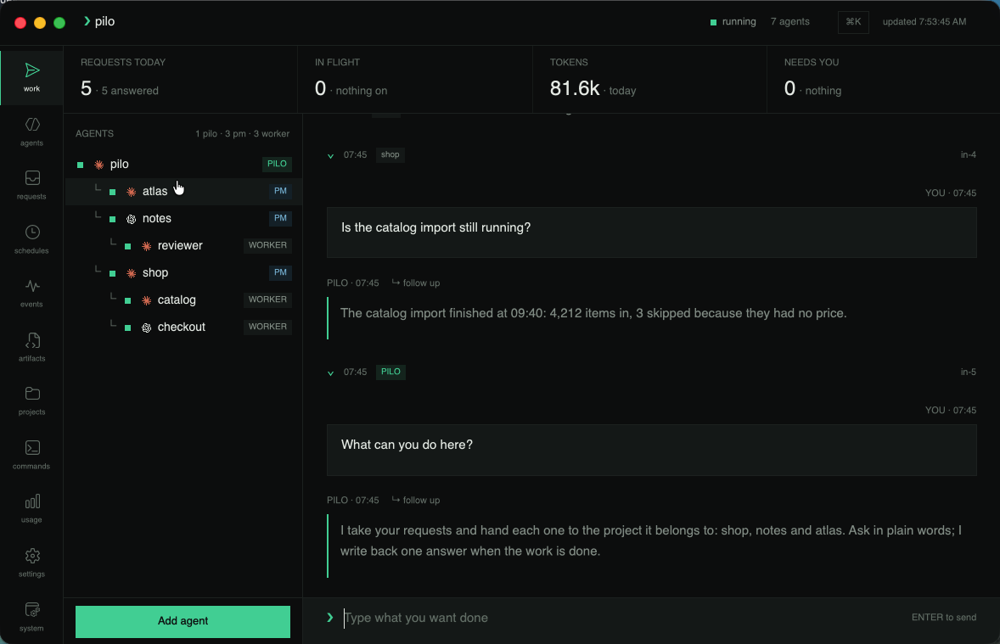

# pilo

**Many agents, one place to talk.**

pilo does not start agents. It gathers the ones already open in your terminal, so
you say a thing once and the owners split the work between them. macOS, local
only, no account.

<picture>
  <source media="(prefers-color-scheme: dark)" srcset="docs/screenshots/cycle-dark.gif">
  
</picture>



*The real screen. The desk above is a sample: three projects — `shop`, `notes`,
`atlas` — and five requests that never happened.*

## Why

Three coding agents open is three conversations cut in half. You remember which
window knows about the checkout code, you paste the same context into the second
one, and by the afternoon the answer you wanted is somewhere in a pane you have
already scrolled past.

pilo puts one desk in front of them. You talk to the desk; it decides whose work
a request is, hands it on, and writes back a single answer. What you asked and
what came back is on record, so tomorrow you do not explain it again.

## How it works

Three kinds of agent, and pilo starts none of them on its own:

| | What it does |
| --- | --- |
| **Desk** (`pilo`) | The only one you talk to. Reads the request, decides whose work it is, gathers what comes back and writes one answer. |
| **Owner** (`pm`) | One project, one owner. Reads only its own folder, does the work, reports to the desk. |
| **Specialist** (`worker`) | Sits under an owner and covers one area — review, QA, a second runtime. Reports to its owner, never to you. |

pilo is one app and one small server, both written in Rust:

- **the pilo app** — your agents' terminals (Claude Code, Codex) live in it, next to
  the desk, the requests, schedules, usage and settings. The terminals belong to
  a background daemon, so closing the window or updating the app leaves every
  session running.
- **the server** — keeps requests and answers in a SQLite file, wakes the agent a
  request is for by typing into its terminal, and answers the agents' `pilo`
  commands over a unix socket.

pilo never speaks to a model provider. Everything stays on your Mac.

## Install

Download `pilo-<version>-mac.tar.gz` from the
[latest release](https://github.com/garamnohhh/pilo/releases/latest), unpack it and run
the installer in a terminal:

```bash
tar xzf pilo-*-mac.tar.gz && ./pilo-*-mac/install.sh
```

It puts the server in `~/.pilo/bin`, the app in `~/Applications/pilo.app`, starts
both at login, adds Pilo's hooks to Claude Code (and Codex, if you have it) and
adds `~/.local/bin` to your shell's `PATH` for the `pilo` command. Nothing needs
sudo, Node or anything else installed first. The build is not notarised yet;
running the installer from the terminal is what keeps macOS from refusing it.

You need at least one coding agent, signed in once: Claude Code
(`curl -fsSL https://claude.ai/install.sh | bash`) or Codex
(`brew install --cask codex`). The app checks for them on its first screen.

New versions show on **System** in the app, with a button that installs them; your
sessions keep running through it.

To remove it: `launchctl bootout gui/$(id -u)/dev.garamnoh.pilo-serve`,
`~/.pilo/desk/bin/pilo-deskd --uninstall-agent`, `pilo hooks remove`, then delete
`~/Applications/pilo.app`, `~/.pilo/bin` and `~/.local/bin/pilo`. Your requests and
their history stay in `~/.pilo` until you remove that too.

## First run

The installer opens the app on **Set up pilo**: four steps, each checking itself,
so you can leave and come back.

| Step | What it asks of you |
| --- | --- |
| **Get ready** | Claude Code or Codex installed, and one session opened in the app (a button does it). |
| **Pick your desk** | Which session is the desk you talk to. |
| **Owners** | Optional: one owner per project session. Their instruction file gets Pilo's rules. |
| **A first request** | Write it in the box on **Work** and watch it come back. |

### Say what you want done

Type it in the box on **Work**. You do not name an agent. The desk reads the
request, splits it when it belongs to more than one project, and hands each part
to the owner of that folder.

While the work is out, the line under your request says who is holding it and
what they last said about it. When everything lands you get one answer, written
in the language you asked in. If something finishes *after* that answer was
written, the desk comes back and adds what changed underneath it.

### Read the trail when you want it

Every request keeps its stages — what you said, who it went to, what each owner
reported, what failed, and the answer that came back — on **Requests**, and
`pilo history <words>` finds what you asked last week.

## What else it does

- **Schedules** — standing work on its own clock: `days:weekday@09:00`,
  `days:2d@14:00`, `every:30`. A job whose last run is still open passes its slot
  instead of stacking a second one.
- **Limits** — when a provider's window runs out, pilo parks that runtime until
  it reopens and hands the parked agent's unopened queue to its owner.
- **Notes** — the desk can also speak first: a job that ran, a limit that landed.
- **Decisions** — when an owner needs you to decide something, the question
  arrives in that conversation and your answer goes back to the work.
- **Approvals** — a session's permission prompts and multiple-choice questions
  show in the app as well as in its own terminal; the first answer wins. A few
  things always ask, whatever the mode, and their card says in red what they
  touch: `rm -rf` outside temporary folders and build output, deleting a remote
  repository, branch or release, a force push over a shared branch, database
  writes, cloud changes, reading `.env` or a secret's value, posting from a
  logged-in browser, messages to people outside, and Pilo's own approvals and
  hooks. Every one of them can be answered from the app, and each answer given
  there is logged (the rule and the tool, not the command). Codex, which takes
  no "ask" from a hook, is held by pilo itself and stopped unless you say yes.

## What it keeps, and where

Everything lives under `~/.pilo/`: `pilo.sqlite` (requests, answers, events),
`port`, `logs/`, and the app's terminal daemon under `desk/`. The only socket that
listens is `127.0.0.1`.

## What it sends

Two things leave your Mac, and both can be switched off:

- **Update check** — every six hours, the newest release on GitHub
  (`api.github.com`). `PILO_UPDATE_CHECK=off` stops it.
- **Usage counts** — once a day, one line to `garamnohh.pages.dev`, so we can see
  how many installs are in use and which features matter. It holds a random
  install id (made on your Mac, tied to nothing), pilo's version, the macOS
  version and chip, how many agents run on Claude Code and on Codex, and how
  many requests, tasks, results, approvals, window choices, schedule runs and
  wakes happened that day. Never any content, prompts, file paths, names,
  accounts or keys; the receiver keeps no IP address. It is on by default:
  untick it on the first screen or in **Settings → Send usage counts**, or set
  `PILO_TELEMETRY=off`. `curl 127.0.0.1:$(cat ~/.pilo/port)/api/telemetry` shows
  the exact line before it goes.

## Commands

```bash
pilo                  # open the app
pilo start            # the server only — pilo stop · pilo restart · pilo status
pilo hooks install    # Pilo's hooks in Claude Code and Codex · pilo hooks remove
pilo inbox [id]       # requests, or one request in full
pilo agents           # id · name · role · project
pilo history <words>  # what was asked, answered and reported before
pilo schedules        # standing work
```

Agents have their own set — `pilo task`, `pilo progress`, `pilo done`,
`pilo block`, `pilo reply` — written into their instruction file when you
register them. `pilo help` lists every one.

## Running a second instance

Every part of the layout moves, which is how a test instance runs beside a real
one: `PILO_HOME`, `PILO_PORT`, `PILO_SOCKET` and `PILO_SPOOL`. Move the socket
and the spool together — the CLI falls back from one to the other, so changing
only one leaves it talking to the instance you meant to leave alone.

## Layout

| Path | Role |
| --- | --- |
| `rust/` | the server, the agent CLI and the hooks, one binary |
| `public/`, `src/*.js` | the design system and markdown files the apps' pages load |
| `conformance/` | scenarios every server build has to pass |
| `scripts/package-mac.sh` | builds the release archive (with the app from `pilo-desk`) |

## Contributing

`cargo test` in `rust/`, and `npm run conformance` against a build
(`PILO_SERVER_CMD="rust/target/release/pilo serve"`). Push one branch at a time —
`git push origin main`, not `--all` and not `--mirror`.

## License

[Apache License 2.0](LICENSE) · Copyright 2026
[garamnoh](https://github.com/garamnohhh) · homepage [pilo.garamnoh.workers.dev](https://pilo.garamnoh.workers.dev)
